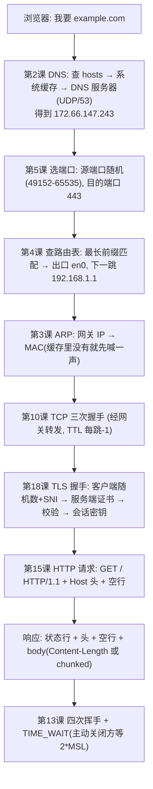
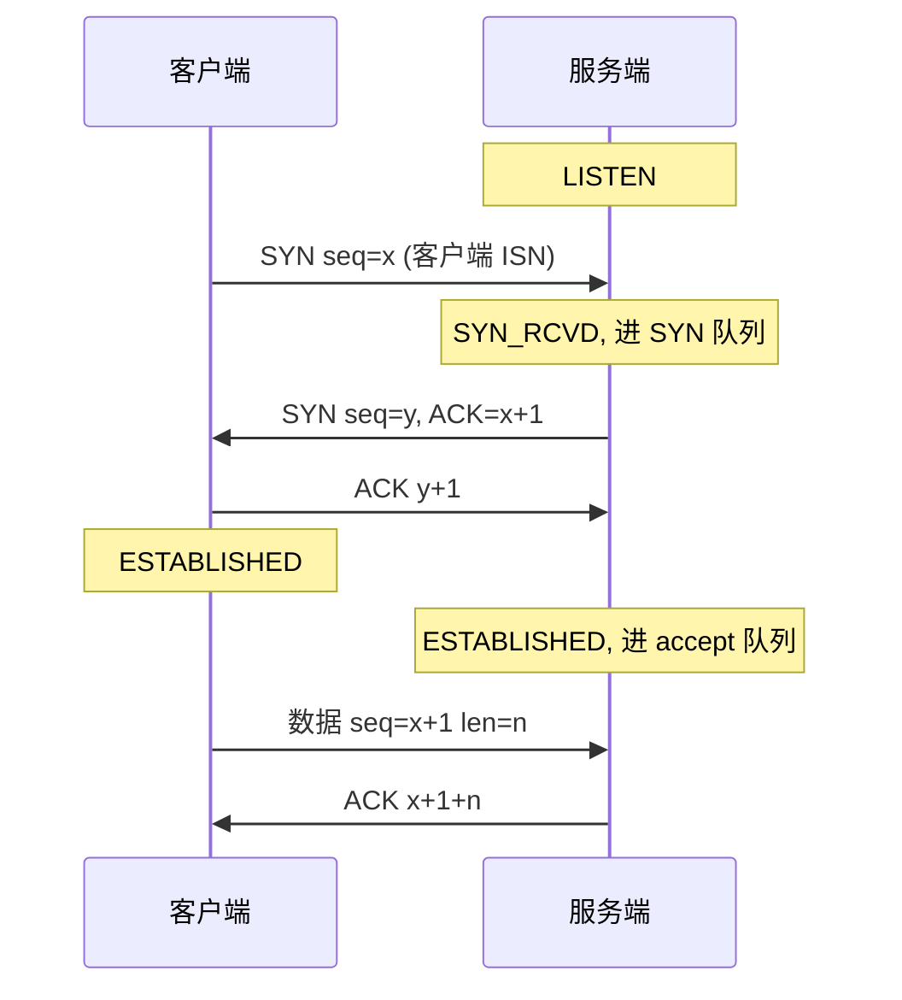
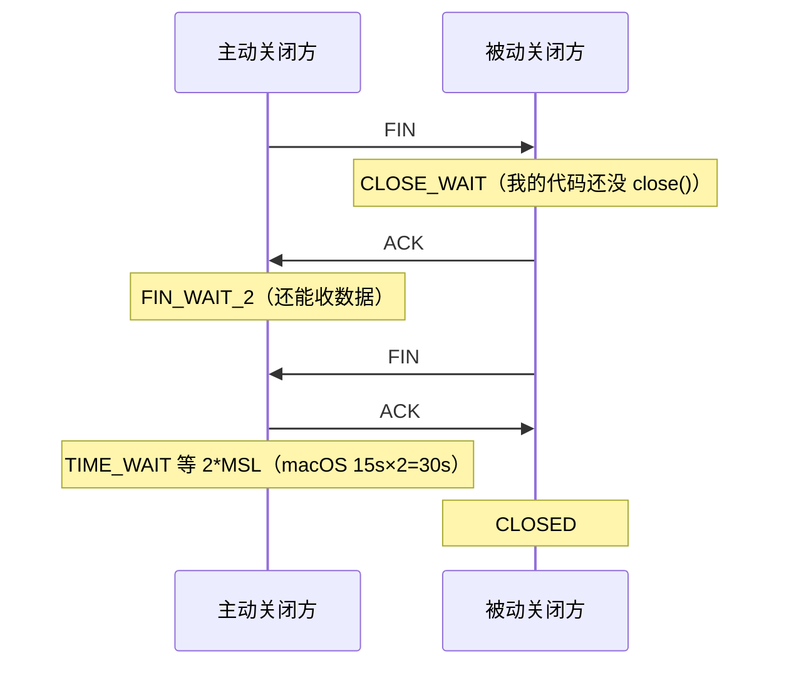
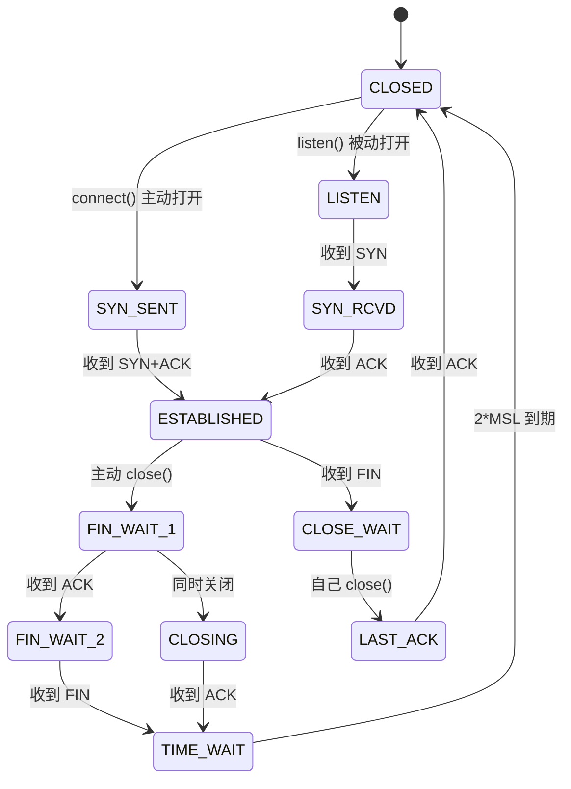
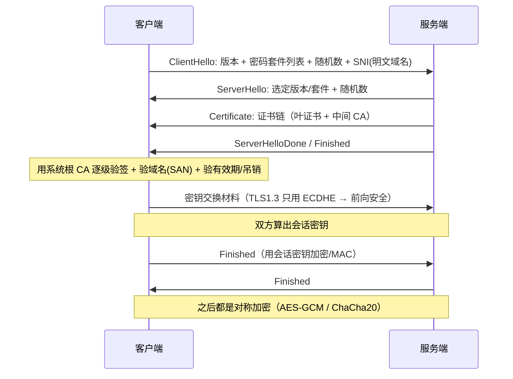
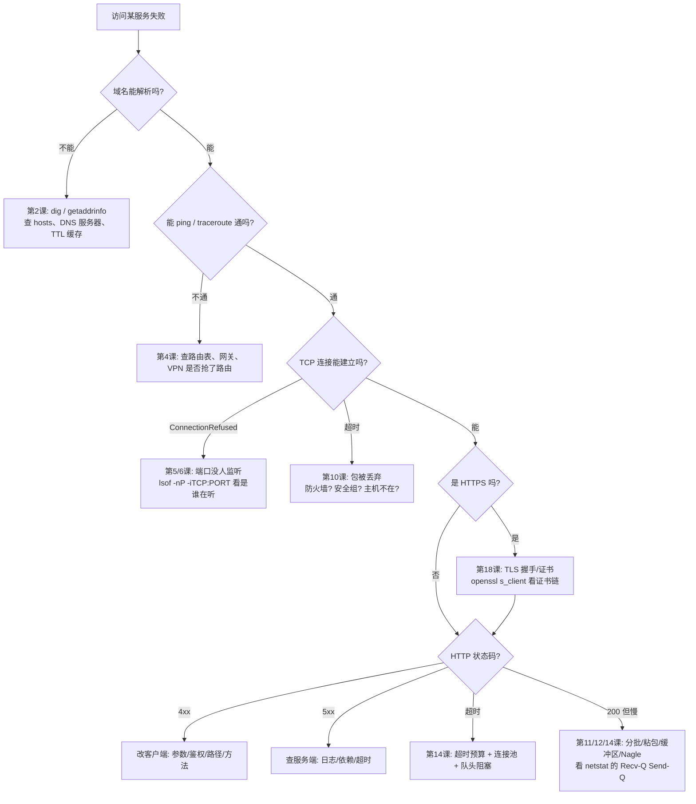

# 网络速查手册（配合 19 课示例使用）

每一节都标注了「对应哪一课」，方便回头查。

---

## 1. 分层模型：一个包是怎么被层层包裹的

| TCP/IP 四层 | OSI 七层 | 数据单位 | 典型协议 | 寻址方式 | 设备 |
|---|---|---|---|---|---|
| 应用层 | 应用/表示/会话 | 报文 message | HTTP, DNS, SMTP, SSH, TLS | 域名 / URL | 主机 |
| 传输层 | 传输层 | 段 segment / 数据报 datagram | **TCP**, **UDP**, QUIC | **端口** | 主机 |
| 网络层 | 网络层 | 包 packet | **IP**, ICMP, ARP* | **IP 地址** | 路由器 |
| 网络接口层 | 数据链路/物理 | 帧 frame / 比特 | 以太网, Wi-Fi, PPP | **MAC 地址** | 交换机/网卡 |

\* ARP 常被归到网络层与链路层之间，作用是「IP → MAC」。

**封装**：`HTTP 数据 → TCP 头+数据 → IP 头+数据 → 以太网头+数据+尾`，每层只关心自己那一段头。
**解封装**：对端反向剥掉。

**一个 GET example.com 的完整旅程**（对应 1~18 课）：



---

## 2. 地址与寻址要点（第 1、3、4 课）

- IPv4 = 32 位整数；点分十进制只是写法；传输用**大端**（网络字节序）。
- 一个地址 = 网络号 + 主机号，由掩码 / 前缀长度切分。
- 同网段：ARP 直达；跨网段：交给默认网关。
- 特殊地址：`0.0.0.0`（bind 通配）、`127.0.0.1`（回环，不出网卡）、
  `169.254/16`（DHCP 失败自分配）、RFC1918 私网、`100.64/10`（CGNAT，Tailscale 也用它）、
  `224/4`（组播）、`255.255.255.255`（受限广播）。
- 路由匹配规则：**最长前缀匹配**（/32 > /24 > /8 > default）。
- MTU 1500 → TCP MSS 1460；隧道网卡 MTU 更小（1280/1400），会让 MSS 变小。

**查看自己机器**：
```bash
ifconfig -a                  # 网卡、MAC、IP、MTU
netstat -rn -f inet          # 路由表
arp -an                      # ARP 缓存
scutil --dns                 # macOS: 实际生效的 DNS 服务器
dig example.com A            # DNS 记录
```

---

## 3. 端口与五元组（第 5、6 课）

- 端口 = 16 位（0~65535）。`0` = 让内核分配。
- 分段：0-1023 系统端口（Unix 需 root）／1024-49151 注册端口／49152-65535 临时端口（macOS 实测范围）。
- 内核用**五元组**区分连接：`协议 + 源IP + 源端口 + 目的IP + 目的端口`。
- 服务端能同时服务海量客户端，靠的是「客户端源端口各不相同」，不是端口多。

**常见端口**：22 SSH｜25 SMTP｜53 DNS｜67/68 DHCP｜80 HTTP｜110 POP3｜123 NTP｜143 IMAP｜
443 HTTPS｜3306 MySQL｜5432 PostgreSQL｜6379 Redis｜27017 MongoDB｜8000/8080 常见 Web｜3000/5173 前端开发。

```bash
lsof -nP -iTCP:8080                 # 谁占了 8080
lsof -nP -iTCP -sTCP:LISTEN         # 所有 TCP 监听者
netstat -an -f inet -p tcp          # 所有 TCP socket 及状态
sysctl net.inet.ip.portrange.first net.inet.ip.portrange.last   # 临时端口范围
```

---

## 4. TCP 三次握手（第 10 课）



- 两个包不够（无法确认「对方收到了我的确认」），三个刚好。
- 握手完成 ≠ 应用层 ready：内核先放进 accept 队列，`accept()` 只是取出来。
- SYN 重传间隔 1/2/4/8/16/32 秒，macOS 累计约 75 秒才失败 → **业务必须自己设超时**。
- backlog 是队列长度，满了会丢 SYN（本机 `listen(1)` 实测 6 次只有 1 次成功）。

**两种失败的区分**（排障关键）：

| 现象 | 异常 | 含义 |
|---|---|---|
| 立刻失败 | `ConnectionRefusedError`（收到 RST） | 网络通、主机在、**端口没人监听**（或防火墙 reject） |
| 卡住后超时 | `socket.timeout` | 包被丢弃/主机不在/路由不通 —— 最难查 |

---

## 5. TCP 是字节流（第 11、12 课）

- `send(n)` 可能只发出部分 → 用 `sendall()` 或自己循环。
- 一次 `recv()` 可能拿到 0.5 条、1 条或 3 条消息 → **必须自己划边界**。
- `recv()` 返回 `b""` 是唯一的 EOF 信号。
- `shutdown(SHUT_WR)` = 半关闭（我说完了，但还能收）。

**三种划边界方案**：

| 方案 | 格式 | 优点 | 典型用途 |
|---|---|---|---|
| 定长 | 每条固定 N 字节 | 解析最快 | 定长头、二进制结构体 |
| 分隔符 | 以 `\n` / `\0` 结束 | 可读、可用 telnet 调试 | HTTP 头、Redis、SMTP、日志 |
| 长度前缀 | `[4字节长度][内容]` | 通用、可预分配 | gRPC、Kafka、几乎所有 RPC |

**接收端铁律**：缓冲区 + 循环取出；长度头要能处理「只收到 2 字节」；对声称的长度做上限校验（防 OOM）。
**测试方法**：把同一段字节流「一次性喂 / 逐字节喂 / 随机切片喂」，三种结果必须一致。

---

## 6. 四次挥手与状态机（第 10、13 课）





**状态 → 问题对照表**：

| 状态 | 出现在 | 意味着 |
|---|---|---|
| `LISTEN` | 服务端 | 正常，等连接 |
| `SYN_SENT` 大量堆积 | 客户端 | 对端无响应（挂了 / 被 DROP / 路由不通） |
| `ESTABLISHED` 长期空闲 | 双方 | 可能是连接池（正常）或连接泄漏 |
| `CLOSE_WAIT` 大量堆积 | 服务端 | **代码 bug**：收到 FIN 没 `close()`，不修永不消失 |
| `TIME_WAIT` 大量堆积 | 主动关闭方 | 短连接太多；换连接池，或从客户端主动关闭 |
| `TIME_WAIT` 少量 | 主动关闭方 | 正常，30 秒后自动消失 |

**为什么 TIME_WAIT 必须存在**：① 最后那个 ACK 丢了还能重发；② 让迟到报文彻底消亡，不串进同四元组的新连接。
**SO_REUSEADDR**：让服务器在 TIME_WAIT 占用端口时仍能 bind（重启必备）。
**SO_LINGER=0**：close 时直接发 RST（暴力断开，可能丢数据）。

**会产生 RST 的场景**：连不存在的端口；往已关闭的连接写；`SO_LINGER=0`；畸形报文；进程被 `kill -9` 后对端继续写。

---

## 7. UDP 要点（第 8、9 课）

- 无连接、不保证送达/顺序、**保留消息边界**、开销小。
- 服务端只要 `bind` + `recvfrom/sendto`，没有 `listen/accept`。
- UDP 的 `connect()` **不发包**，只绑定默认对端、锁定源 IP/端口，并让你能通过 `recv` 感知 ICMP 错误。
- 载荷上限 65507 字节，但超过路径 MTU（1460/1472）会分片，任一分片丢失整个数据报就废 → 实际建议 ≤ 1200。
- 丢包在你自己机器上就能复现（接收缓冲区满 = 静默丢弃）。

**UDP 上做请求-响应必须自己实现**：事务 ID 配对 + 超时重试 + 重复包丢弃（DNS 就是这么干的）。

---

## 8. HTTP 速查（第 15~17 课）

**报文形状**：
```
请求:  方法 SP 路径 SP 版本 CRLF  *(头 CRLF)  CRLF  [body]
响应:  版本 SP 状态码 SP 原因 CRLF  *(头 CRLF)  CRLF  [body]
```

**响应体长度的三种界定**：`Content-Length` ／ `Transfer-Encoding: chunked`（十六进制块长 + CRLF，0 块结束）／ `Connection: close`（读到 EOF）。
对应第 12 课的「定长 / 长度前缀 / EOF 三件套」。

**方法**：GET 取（可缓存）｜POST 提交（不幂等）｜PUT 整体替换（幂等）｜PATCH 局部｜
DELETE 删（幂等）｜HEAD 只要头｜OPTIONS 问支持什么（CORS 预检）。

**状态码**：
- 1xx 信息（100 Continue, 101 Switching Protocols）
- 2xx 成功（200 OK, 201 Created, 204 No Content, **206 Partial Content**）
- 3xx 重定向（301 永久, 302/307 临时, **304 Not Modified**）
- 4xx 客户端错（400, 401 未认证, 403 无权限, 404, 405 方法不对, 413 太大, 416 Range 越界, 429 限流）
- 5xx 服务端错（500, 502 网关收到坏响应, 503 过载/维护, 504 网关超时）

排障口诀：**4xx 改调用方，5xx 查服务方，3xx 看 Location，1xx 基本不用管。**

**必记头**：请求侧 `Host`(1.1 必需) / `User-Agent` / `Accept-Encoding` / `Cookie` / `Authorization` / `Content-Type` / `Content-Length` / `Origin`；
响应侧 `Content-Type` / `Content-Length` / `Transfer-Encoding` / `Set-Cookie` / `Cache-Control` / `ETag` / `Last-Modified` / `Location` / `Connection`。

**缓存协商**：首次响应带 `ETag`/`Last-Modified` → 下次请求带 `If-None-Match`/`If-Modified-Since` → 没变就回 **304**（无 body）。
**断点续传**：请求 `Range: bytes=0-99` → 响应 **206** + `Content-Range: bytes 0-99/59220`；越界回 416。

**版本演进**：
| 版本 | 关键改进 | 遗留痛点 |
|---|---|---|
| 1.1 | keep-alive、Host 虚拟主机、chunked、Range | 一条连接同时只能一个请求（队头阻塞） |
| 2 | 二进制分帧、多路复用、HPACK 头压缩 | TCP 层队头阻塞（丢包拖累所有流） |
| 3 | QUIC/UDP、每流独立、0-RTT、连接迁移 | 部署复杂（UDP 常被限速/拦截） |

---

## 9. TLS / HTTPS（第 18 课）



- HTTPS = 在 TCP（或 QUIC）之上先做 TLS，再把 HTTP 塞进去；协议内容一个字没变。
- **安全性来自「证书链 + 主机名校验」，不是「加密」本身**（自签证书实验证明了这点）。
- SNI：一个 IP 服务无数域名，握手时明文告知 → 中间人能看到域名（ECH 正在解决）。
- ALPN：握手里顺便协商 `h2` / `http/1.1`。
- 证书最重要的字段是 **SAN**（现代客户端不看 CN）；有效期通常 90 天 → **必须自动化续期**。
- 生产禁止：`verify=False`、`curl -k`、`rejectUnauthorized: false`（测试环境除外）。

**排障**：
```bash
openssl s_client -connect example.com:443 -servername example.com -showcerts
openssl x509 -in cert.pem -noout -subject -issuer -dates -ext subjectAltName
```
`hostname mismatch` → 看 SAN；`unable to get local issuer` → 服务端没发中间证书或客户端 CA 库太旧；`expired` → 过期。

---

## 10. Socket 选项速查（第 14 课）

| 选项 | 默认 | 什么时候用 | 注意 |
|---|---|---|---|
| `SO_REUSEADDR` | 0 | **所有服务端都要开** | 只解决 TIME_WAIT 占用，不能让两个 socket 同时监听同地址 |
| `SO_REUSEPORT` | 0 | 多进程共享同一端口分摊连接 | 与 REUSEADDR 不是一回事 |
| `TCP_NODELAY` | 0 | 低延迟交互（RPC/游戏/Redis） | 批量场景先做应用层合并更重要 |
| `SO_SNDBUF`/`SO_RCVBUF` | 内核自适应（本机实测 143KB/398KB） | 高 BDP 链路按 带宽×RTT 调 | 设了要用 `getsockopt` 读回实际值 |
| `SO_RCVTIMEO` | 无 | 想要内核级超时 | **CPython 下会抛 `BlockingIOError` 而非 `socket.timeout`**，建议统一用 `settimeout` |
| `SO_KEEPALIVE` | 0 | 长连接兜底 | 默认空闲 7200s + 75s×8 次 ≈ 2 小时才判死，**必须用应用层心跳** |
| `TCP_MAXSEG` | 协商值（回环 16332 / 以太网 1460） | 排查分片和性能 | 只读为主 |
| `SO_LINGER` | 关 | 需要立即断开（发 RST） | 会丢数据，慎用 |
| `SO_ERROR` | 0 | **非阻塞 connect 必须读它** | 读一次即清除 |

---

## 11. 排障决策树



**黄金命令组合**：
```bash
# 1. 解析对不对
dig +short example.com
# 2. 通不通
traceroute -n -m 8 example.com      # 哪一跳开始不通
# 3. 端口通不通（不用 nc 也能测）
python3 -c "import socket;s=socket.socket();s.settimeout(2);print(s.connect_ex(('example.com',443)))"
# 4. 谁在占端口
lsof -nP -iTCP:8080
# 5. 连接状态分布
netstat -an -f inet -p tcp | awk '{print $NF}' | sort | uniq -c | sort -rn
# 6. TLS 细节
openssl s_client -connect example.com:443 -servername example.com </dev/null 2>/dev/null | head -30
# 7. HTTP 细节（看请求响应头、是否复用连接）
curl -v --http1.1 https://example.com/ -o /dev/null
```

---

## 12. 一页数字速记

| 数字 | 含义 |
|---|---|
| 1500 / 1460 | 以太网 MTU / TCP MSS（IPv4 无选项） |
| 16384 / 16332 | 本机回环 MTU / 实测 MSS |
| 1472 | UDP 不分片的最大载荷（1500-20-8） |
| 65507 / 65535 | IPv4 下 UDP 载荷上限 / 端口与 UDP 长度字段上限 |
| 12 | DNS 报文头固定长度（字节） |
| 20 / 60 | TCP 头最小 / 最大长度（字节，含选项） |
| 8 | UDP 头长度（字节） |
| 2*MSL | TIME_WAIT 时长（macOS MSL=15s → 30s） |
| 75 秒 | Linux/macOS 默认 SYN 重传总时长 |
| 7200s / 75s / 8 | TCP keepalive 空闲 / 间隔 / 次数（≈2 小时后才判死） |
| 49152-65535 | macOS 临时端口范围 |
| 6 | 浏览器对同一域名常见的并行连接数上限（HTTP/1.1 时代） |

---

## 13. 六条工程结论（这套课最想让你记住的）

1. **TCP 是字节流，没有消息边界**；协议必须自己划边界（长度/分隔符/定长），并用「逐字节喂」测试解码器。
2. **TCP 保证有序不丢，UDP 不保证，但 UDP 保留边界**；两者没有优劣，只有取舍（HTTP/3 用 UDP 自己实现可靠性就是证明）。
3. **超时必须分三层设**（连接/读/总），且遵守「下游超时 < 上游超时」；不设超时是最常见的生产事故。
4. **连接复用是第一性能杠杆**：连接池 / keep-alive 省掉握手与 TIME_WAIT，比任何 socket 选项都有效。
5. **状态是排障的通用语言**：LISTEN/ESTABLISHED/TIME_WAIT/CLOSE_WAIT 各自指向不同的问题（自己写代码没关 → CLOSE_WAIT）。
6. **HTTPS 的安全来自信任链而不是加密**：证书链、SAN、有效期三项校验缺一不可，所以 `verify=False` 等于没有 HTTPS。
