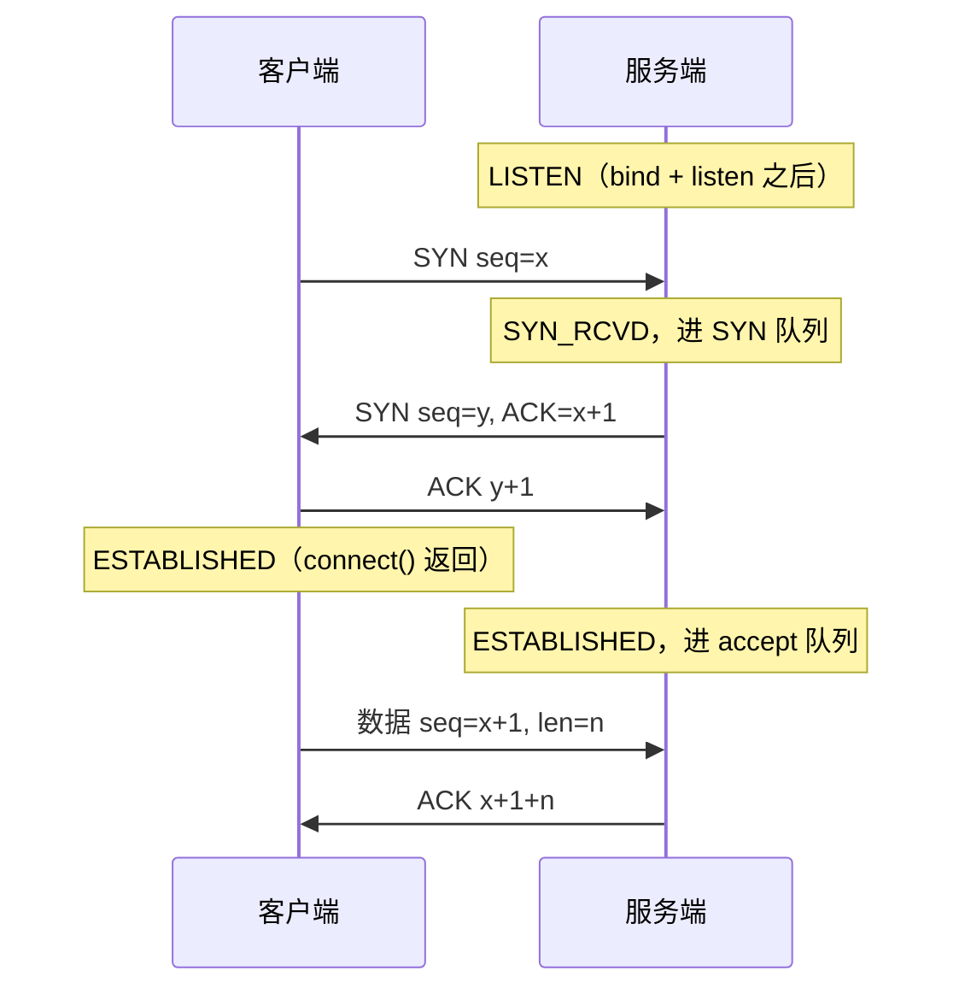
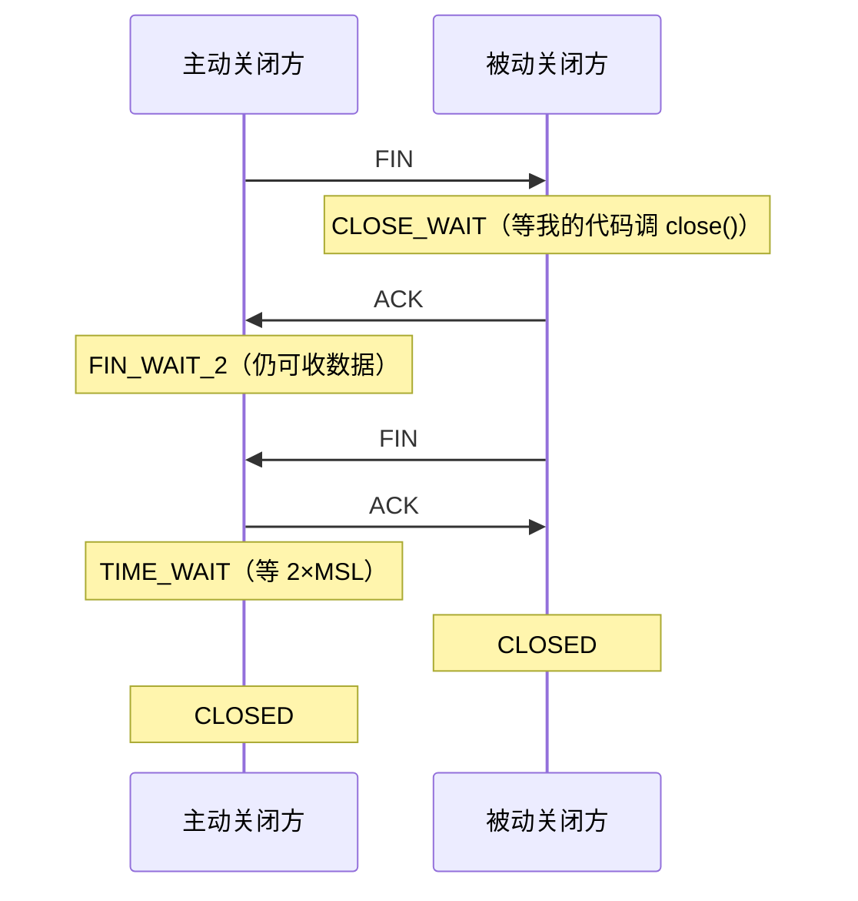

# 第 4 章：TCP（第 10~14 课）

本章解决的问题：**「怎么把字节可靠、有序地送到对端，代价是什么」**。
五课依次是：握手 → 字节流语义 → 粘包与分帧 → 挥手与状态 → socket 选项调优。

代码：`04_tcp/demo_10_tcp_handshake.py` ~ `demo_14_tcp_socket_options.py`

这是全课程最重的一章。学完它，你应该能：

1. 在纸上画出三次握手/四次挥手，并说清每个状态出现在谁那一侧；
2. 解释「为什么 TCP 必须有粘包问题，而 UDP 没有」；
3. 拿到一个 `BrokenPipeError` / `CLOSE_WAIT` / 连接超时，知道先看什么。

---

## 第 10 课：三次握手

**一句话**：三次握手解决「双向可达 + 初始序号同步 + 窗口与选项协商」，两个包不够，三个刚好。

### 【原理】TCP 头里真正重要的四个字段

```
+---------------------------------------------------+
| 源端口 (2) | 目的端口 (2)                          |  ← 定位进程（第 5 课）
| 序号 seq (4)                                      |  ← 我这份数据的第一个字节编号
| 确认号 ack (4)                                    |  ← 我期望你下次发的编号
| ... 标志位: SYN ACK FIN RST PSH URG ECE CWR ...    |
| 窗口大小 (2) | 校验和 (2) | 紧急指针 (2)            |
+---------------------------------------------------+
```

**序号/确认号是 TCP 一切可靠性的基础**：它把字节流切成可编号的片段，
于是能确认收到（ACK）、能重传缺失、能排序、能去重。
代价是：**应用层的「消息边界」被丢掉了**（第 12 课的主题）。



**关键概念：握手完成 ≠ 应用层 ready**。第三次 ACK 之后连接就已经建立，
内核把它放进 **accept 队列**；你的 `accept()` 只是「从队列里取一个」。
所以程序忙得没来得及 accept，客户端照样能连上。

### 【实测】`04_tcp/demo_10_tcp_handshake.py`

**① 抓到 `SYN_SENT`**（正常连接时这个状态只存在几毫秒，靠连一个不回应的地址才抓得到）：

```text
    目标 ('192.0.2.1', 80)    观察到的状态: ['SYN_SENT']
      <- 抓到 SYN_SENT: 说明「SYN 已发出、还没收到 SYN+ACK」。
         正常连接时这个状态只存在几毫秒（本地回环上更短）, 所以平时根本看不到。
         如果大量连接卡在 SYN_SENT, 说明对端没响应（服务挂了/端口被 DROP/路由不通）。
```

> 注：`192.0.2.1` 是 TEST-NET 保留地址，理论上不回应。但本机若开了 TUN/透明代理，
> 连接会被劫持成 `ESTABLISHED`，反而抓不到 `SYN_SENT`。这是环境差异，不是代码错；
> 输出取决于本机是否启用代理。

**② 同一根连接的两个视角是镜像的**：

```text
    客户端视角: 本地端 ('127.0.0.1', 61863) <-> 对端 ('127.0.0.1', 61861)
    服务端视角: 本地端 ('127.0.0.1', 61861) <-> 对端 ('127.0.0.1', 61863)
    netstat 里端口 61861 的状态: {'ESTABLISHED': 2, 'LISTEN': 1}
```

```
客户端 getpeername() == 服务端 getsockname()
客户端 getsockname() == 服务端 getpeername()
```

**③ 两种「连不上」的区别**（排障最常用的一张表）：

```text
  连 192.0.2.1:80 -> socket.timeout（我们自己设的 1 秒到了就放弃, 实际等了 1.00s）
  连 127.0.0.1:1 -> ConnectionRefusedError（只等了 0.0006s）
```

> 注：第一行的结果取决于本机网络环境（透明代理会把「超时」变成「立刻成功」），
> 属于环境差异；第二行的 `ConnectionRefusedError` 在任何环境下都稳定可复现。

| 现象 | 异常 | 含义 |
|---|---|---|
| 立刻失败（0.6 毫秒） | `ConnectionRefusedError`（收到 RST） | 网络通、主机在、**端口没人监听**（或防火墙 reject） |
| 卡住后超时 | `socket.timeout` | 包被丢弃 / 主机不在 / 路由不通 —— **最难查的一种** |

**④ 连接建立的内核上限**（代码里动态读出来，而不是背数字）：

```text
  本机实测这个上限:
    net.inet.tcp.keepinit = 75000 ms  -> 连接建立阶段最多等 75 秒（macOS 用这一个旋钮控制）
    Linux 上对应的旋钮叫 net.ipv4.tcp_syn_retries, 默认 6 次重传 ≈ 127 秒
```

原理：SYN 发出去没响应就重传，间隔翻倍（1/2/4/8/16/32 秒）。
**默认要等一分多钟才会有结果 —— 所以业务必须自己设超时。**

**⑤ backlog 满了会怎样**（`listen(1)` 且故意不 accept）：

```text
  在 listen(1) 下, 有 1/6 次连接成功进入内核队列（本平台实测, 仅供参考）
  之后 accept() 逐个取走, 一共取到 1 个连接（它们一直在队列里等我）
```

第 2~6 次连接直接超时（SYN 被丢弃）。这条实测的意义：
**「连接建立完成」不等于「业务已经处理」**。把耗时逻辑塞在 accept 之前/之后，
都会让队列堆积，突发流量时用户看到的就是超时。

### 【坑】

- 只设了业务超时、没设 `connect` 超时 → 内核等 75 秒，上游早超时了。
  正确顺序：**连接超时 < 读超时 < 业务总超时**，且「下游超时 < 上游超时」。
- 以为 `listen(backlog)` 是「最大连接数」：它是**队列长度**，不是并发上限。
- `accept()` 拿到的 `conn` 是**新 socket**（对它做 `getsockname()` 会看到客户端地址）。
  常见 bug：把监听 socket 和新连接 socket 搞混，导致关错了对象。

### 【练习】

把 `listen(1)` 改成 `listen(64)`，6 次连接全部成功；
再把它改回 `listen(0)` 看看本平台的边界行为。

---

## 第 11 课：TCP 上是「字节流」，不是「消息」

**一句话**：TCP 保证「字节有序、不丢不重」，但**不保留你 `send` 的边界**；
一次 `recv()` 拿到多少，由内核缓冲区决定。

### 【原理】为什么会这样

```
应用层 send("hello") + send("world")
   ↓ 内核只看成一串字节 "helloworld"（编号 1..10）
   ↓ 可以一次发出去，也可以拆成 3 个报文段发
   ↓ 接收方 recv() 从流里取多少，完全由「缓冲区当时有多少数据」决定
```

由此推出三条铁律：

1. `send(n)` 可能只发出去一部分 → 用 `sendall()` 或自己循环；
2. 对方一次 `recv` 可能拿到 0.5 条、1 条或 3 条消息 → **要自己划边界**（第 12 课）；
3. `send` 成功 ≠ 对方已收到（数据可能还在本机内核缓冲区）→ 需要应用层确认。

### 【实测】`04_tcp/demo_11_tcp_echo.py`

**① 1 MiB 数据被切成了多少次 `recv`**：

```text
  准备发送 1048576 字节（1 MiB）, 服务端 recv 上限 = 4096 字节
  结果:
    客户端发出去   : 1048576 字节
    服务端收回来   : 1048576 字节（内容一致: True）
    服务端 recv 次数: 257 次（每次上限 4096 字节）
    实际每次长度   : 最小 1768 / 最大 4096 字节
    前 12 次的长度 : [4096, 4096, 4096, 4096, 4096, 4096, 4096, 4096, 4096, 4096, 4096, 4096]
    客户端耗时     : 1.5 ms（本地回环, 约 678.9 MB/s）
```

**这张表就是「TCP 没有消息边界」的铁证**：接收端的 `recv(4096)` 只是「上限」，
实际拿到多少取决于发送速度、内核缓冲区、网络状况。所以**任何按「一次 recv = 一条消息」
写的代码都是错的**（只是小消息 + 本地测试时看起来能跑）。

**② `send()` 的返回值陷阱**：

```text
  SO_SNDBUF 设为 8192（系统实际给 65328）
  第 3 次 send -> BlockingIOError（缓冲区满了, 非阻塞下立刻报错）
  成功 send 了 2 次, 累计 130656 字节, 每次返回: [65328, 65328]
```

（成功次数随运行波动：取决于内核什么时候回收缓冲区，本机多次运行会在 1~2 次之间跳；
关键在于它远小于我们尝试的 200 次。）

同时注意「设了 8192，系统给 65328」——**内核会调整你设的值，所以永远要用 `getsockopt` 读回实际值**。

**③ EOF 与半关闭**：

```python
client.shutdown(socket.SHUT_WR)   # 只关「我发」的方向，我还能收
# 服务端 recv() 得到 b"" —— 这是唯一的「对端说完」信号
```

| 调用 | 效果 |
|---|---|
| `shutdown(SHUT_WR)` | 发送方向结束（发 FIN），仍可 `recv` → 用于「请求体结束、等响应」 |
| `close()` | 释放 fd，两个方向都不能再用 |

**④ 顺序保证**（对照第 8 课的 UDP）：

```text
  发送 200 条编号, 收回 200 条
  顺序是否正确: True
  有无丢失: True
```

我们故意把 200 条消息切成 37 字节的小块发送，接收端拿到的仍然是有序完整的。
**注意：即使是这样，对方也看不出我们「切了 37 字节」——边界依然不存在。**

### 【坑】

- 用 `send` 发大文件、以为发完就 `close()` → 对端收到半个文件。用 `sendall()`。
- 把 `recv(1024)` 当成「读一条消息」→ 消息长了被截断，短了多条粘一起（下节课详解）。
- 忘记 `recv` 返回 `b""` 表示 EOF，写成 `while data:` → 处理不到正常关闭分支。

### 【练习】

把 1 MiB 改成 64 MiB，并且把服务端 `recv(4096)` 改成 `recv(1024)`，
观察 `recv` 次数与耗时（体会「缓冲区大小 vs 系统调用次数」的权衡）。

---

## 第 12 课：粘包与分帧（TCP 编程最大的坑）

**一句话**：粘包/拆包不是 bug，而是「字节流没有边界」的两种表现；
解决办法只有三种：定长、分隔符、长度前缀。

### 【原理】同一件事的两种方向

```
粘包（coalescing）  : 你分 3 次 send, 对方一次 recv 就拿到 3 条
拆包（fragmentation）: 你一次 send 一条 1000 字节, 对方要 recv 3 次才凑齐
```

### 【实测】`04_tcp/demo_12_tcp_sticky_packet.py`

**① 粘包实证**（客户端连发 3 条「消息N」，每条 7 字节）：

```text
  服务端一次 recv 拿到的字节数: 21
  一次 sendall 只有 7~8 字节, 而 recv 拿回了 21 字节, 明显是 3 条粘在一起。
```

对比第 8 课的 UDP：那里 3 次 `sendto` 就是 3 次 `recvfrom`。**同样的代码意图，两种协议两种结果。**

**② 方案 A 定长**：每条 8 字节，不足补空格。

```text
  回显服务端把原始字节原样发回, 我们用定长规则解出: [b'hello', b'world', b'hi']
  残留的不足一条的字节: b''（这种情况必须留在缓冲区里等下一次 recv）
```

**③ 方案 B 分隔符（`\n`）**：

```text
  发送时被切成 b'line-1' + b'\nline-2\nline-3\nline-4\n' 两段（人为拆包）
  按 \n 解析出的消息: [b'line-1', b'line-2', b'line-3', b'line-4']
```

**④ 方案 C 长度前缀（推荐）**——核心是那个**不依赖 recv 切分方式**的解码器：

```python
class LengthPrefixedDecoder:
    HEADER = struct.Struct("!I")          # 4 字节大端长度

    def feed(self, data: bytes) -> list[bytes]:
        self.buf += data
        out = []
        while True:
            if len(self.buf) < self.HEADER.size:
                break                                  # 连长度头都不够
            (length,) = self.HEADER.unpack_from(self.buf, 0)
            if length > self.max_message_size:
                raise ValueError("消息长度超过上限（防内存攻击）")
            total = self.HEADER.size + length
            if len(self.buf) < total:
                break                                  # body 还没收齐
            out.append(bytes(self.buf[self.HEADER.size:total]))
            del self.buf[:total]                       # 只消费这一条
        return out
```

**用三种极端喂法验证它**（这是本课最值得带走的方法论）：

```text
    喂法 1（一次性喂完）: 解出 5 条 -> [1, 11, 0, 5000, 12]
    喂法 2（逐字节 1 个 1 个喂）: 解出 5 条 -> [1, 11, 0, 5000, 12]
    喂法 3（随机 1~64 字节切片）: 解出 5 条 -> [1, 11, 0, 5000, 12]
    三种喂法结果完全一致且与原始消息相同? True
```

（解出的 5 条里包含一条长度为 0 的消息和一条 5000 字节的消息，都是边界情况。）

**⑤ 网络上再来一遍**（客户端把 5 条消息拼成一段，随机切成 257 次发送）：

```text
  客户端把 5 条消息拼成 5044 字节, 随机切片发送:
    实际切成 257 次发送, 前 10 次大小 [35, 9, 37, 37, 31, 16, 31, 27, 13, 7]
  服务端按协议解出消息并逐条 ACK, 客户端解出 5 条回复:
```

服务端能做到「逐条 ACK」，是因为它先用解码器切出了**完整的消息**，
而不是把 `recv` 的返回值当消息。

### 【坑】

- 用 `data.split(b"\n")` 直接切 → 最后一段可能是半条消息。必须保留残留（流式解析）。
- 长度头只写了「够不够读 body」，忘了「够不够读头本身」（只收到 2 个字节时）。
- 不做最大长度校验 → 一个伪造的「长度 = 4GB」头就能把你的内存打满（真实 CVE 的常见形态）。
- 只考虑「客户端分 3 次 send」→ 忘了网络还可能把一次 send 拆开（本课用 37 字节切片模拟的就是这个）。

### 【练习】

把 `LengthPrefixedDecoder(max_message_size=100)` 传进去，观察超大消息如何被拒绝；
再把 `feed` 的调用改成「先喂 2 字节、再喂剩余」，确认解码器依然正确。

---

## 第 13 课：连接怎么结束（四次挥手 / TIME_WAIT / CLOSE_WAIT / RST）

**一句话**：关闭是双向的所以要四次挥手；`TIME_WAIT` 属于主动关闭方，
`CLOSE_WAIT` 属于「代码忘了关」的一方 —— 这两个状态能直接定位故障归属。

### 【原理】四次挥手



**为什么必须有 TIME_WAIT（30 秒不是浪费）**：

1. 最后那个 ACK 丢了，对方会重发 FIN，我还能再 ACK 一次；
2. 让这条连接的「迟到报文」彻底消亡，不会串进同四元组的新连接。

完整状态机（含 `SYN_SENT`/`FIN_WAIT_1`/`LAST_ACK`/`CLOSING`）见 `../NOTES.md` 第 6 节。

### 【实测】`04_tcp/demo_13_tcp_teardown.py`

**① 挥手走到一半时，两侧分别在等什么**（服务端主动关闭 8 条，客户端故意不关）：

```text
  本机 net.inet.tcp.msl = 15000 ms, 所以 TIME_WAIT 会持续 2*MSL = 30 秒
  建立连接之前的状态统计: {'LISTEN': 1}
  服务端主动关闭 8 条连接后: {'FIN_WAIT_2': 8, 'CLOSE_WAIT': 8, 'LISTEN': 1}
```

这张表里两侧的连接都在（`netstat` 里 Local/Foreign 任一列命中该端口都会被筛出来），
而且**两边都在等对方**：

- `FIN_WAIT_2 ×8`：服务端（主动关闭方）已发出 FIN 并收到 ACK，在等对方的 FIN；
- `CLOSE_WAIT ×8`：客户端收到了 FIN，但代码还没调 `close()`；
- `LISTEN ×1`：监听口还在。

**注意此时还没有 TIME_WAIT** —— 因为挥手还没走完。等双方都关掉（见第 3 步），
主动关闭方才会进入 TIME_WAIT，数量会涨到几十条（实测 25 条）。

**② 复现 CLOSE_WAIT**（客户端发 FIN，服务端故意不 `close()`）：

```text
    此时服务端端口状态: {'CLOSE_WAIT': 1, 'FIN_WAIT_2': 1, 'LISTEN': 1, 'TIME_WAIT': 8}
  调用 conn2.close() 之后: {'LISTEN': 1, 'TIME_WAIT': 9}   <- CLOSE_WAIT 立刻消失
```

一次实验同时看到两个状态：**服务端 CLOSE_WAIT**（我的代码没关）+
**客户端 FIN_WAIT_2**（我关了、对方还没关）。

| 状态 | 出现在 | 意味着 | 怎么处理 |
|---|---|---|---|
| `TIME_WAIT` 少量 | 主动关闭方 | 正常，30 秒自消 | 不用管 |
| `TIME_WAIT` 上万 | 主动关闭方 | 短连接太多 | 连接池 / keep-alive |
| `CLOSE_WAIT` 长期存在 | 被动关闭方 | **代码没 close()** | 改代码：`with` / `try-finally` |
| `SYN_SENT` 堆积 | 客户端 | 对端无响应 | 查对端/网络（第 10 课） |

**③ `SO_REUSEADDR`：为什么重启服务器必须加它**：

```text
  旧服务端已关闭, 现在端口 61892 的状态: {'TIME_WAIT': 25}
  不加 SO_REUSEADDR 直接 bind: 失败 -> OSError: [Errno 48] Address already in use
      <- 明明没有进程在监听了, 却还是 Address already in use, 就是 TIME_WAIT 在占位。
  加上 SO_REUSEADDR 后 bind 同一个端口: 成功  <- 这就是每个服务端都该有的那一行
```

**④ `SO_LINGER=0`：用 RST 代替 FIN**：

```text
  客户端设置 SO_LINGER=(1, 0) 然后 close()
  服务端 recv -> ConnectionResetError: [Errno 54] Connection reset by peer
```

**⑤ 对端已关闭，继续写会怎样**：

```text
    第 1 次 send 返回 16 字节（看起来成功, 其实只是写进了内核缓冲）
    第 2 次 send -> BrokenPipeError: [Errno 32] Broken pipe
```

**这个实验解释了一个经典现象**：「日志显示消息发出去了，但对方说没收到」。
因为 `send` 成功只代表**字节进了本机内核缓冲区**。

**⑥ `--wait` 模式：亲眼看 TIME_WAIT 到期**（脚本额外等 35 秒打印一次状态）：

```text
  当前端口 57589 状态: {'TIME_WAIT': 25}
    t+ 5s: {'TIME_WAIT': 25}
    t+25s: {'TIME_WAIT': 25}
    t+30s: {}
    t+35s: {}
  TIME_WAIT 消失 -> 这正是 2*MSL 到期。
```

> 注：这一段来自 `python3 04_tcp/demo_13_tcp_teardown.py --wait`。端口号、TIME_WAIT 条数、
> 各时刻的剩余数量，**每次运行都不同**；`run_all.sh` 默认不跑 `--wait`（会多等 35 秒），
> 所以它不在本次运行清单里 —— 这是场景差异，不是文档写错。想亲手复现请自己加 `--wait`。

### 【会产生 RST 的场景清单】

1. 向「没有监听者的端口」发起连接（第 7 课的端口扫描就是靠它判断 closed）
2. 向一条已经彻底关闭的连接发数据
3. `SO_LINGER=0` 后 `close()`
4. 收到不合法报文（seq 完全对不上等）
5. 服务端进程被 `kill -9` 后，客户端继续发数据
6. SYN/accept 队列满时，有的内核配置会用 RST 拒绝

Python 里的表现：`ConnectionResetError`（复位）/ `BrokenPipeError`（再写已断连接）/
`ConnectionAbortedError` / `ConnectionRefusedError`（连接阶段被拒）。
它们都继承自 `OSError`，但**处理策略不同**（能不能重试）。

### 【坑】

- 客户端/服务端「谁先关」决定了 TIME_WAIT 落在谁头上：高并发短连接的服务端
  如果把关闭主动权握在自己手里，会持续制造 TIME_WAIT，极端情况耗尽临时端口。
- 看到 `CLOSE_WAIT` 就去调查询内核参数 —— 那是浪费。**它一定是代码没关**。
- `SO_REUSEADDR` 不能让两个 socket 同时监听同一端口（那是 `SO_REUSEPORT`，第 5 课）。

### 【练习】

给 `demo_13` 加 `--wait` 参数运行，观察 25 条 TIME_WAIT 在 t+30s 全部消失；
再把 `conn2.close()` 注释掉，观察 CLOSE_WAIT 如何一直留在那里。

---

## 第 14 课：常用 socket 选项的实测效果

**一句话**：选项解决的是「已经正确的代码的效率」；不理解语义就调参，只会引入随机故障。

### 【实测】`04_tcp/demo_14_tcp_socket_options.py`

**① 本连接协商出的 MSS**：

```text
  连接的 TCP_MAXSEG = 16332 字节
```

回环 MTU 16384 − 20（IP）− 20（TCP）≈ 16332。真实以太网上你会看到 1460，
中间有隧道时可能是 1400/1280。**做自定义协议（如基于 UDP 的 QUIC）时必须自己按它控包大小。**

**② Nagle 与 `TCP_NODELAY`（这次实测结果是反直觉的）**：

```text
    TCP_NODELAY=0（Nagle 生效）:     2.40 ms
    TCP_NODELAY=1（不等, 直接发）:    11.21 ms
    差异: 本地回环上 8.81 ms（Nagle 更快）
```

**诚实结论**：在本地回环上差别很小甚至**反转** —— 回环的 ACK 立即返回，Nagle 几乎不等待；
反过来开 NODELAY 后 2000 次 1 字节写变成 2000 个报文，系统调用/中断开销反而更大。

真实网络上才有经典结论：**Nagle + 延迟确认（delayed ACK）叠加会造成几十毫秒的延迟尖刺**，
所以 Redis / MySQL / gRPC / 游戏同步都默认开 `TCP_NODELAY`。

正确姿势是：**先消除「2000 次 1 字节写」这种设计，再考虑选项**。

**③ 缓冲区与吞吐**：

```text
  本机默认 SO_SNDBUF = 146988 字节, SO_RCVBUF = 408300 字节
  传输 32 MiB 实测:
    默认缓冲区   :     10.3 ms  ->  3259 MB/s
    SNDBUF=8192 :     63.6 ms  ->   528 MB/s
```

缓冲从 ~143KB 缩到 8KB，吞吐掉到 **1/6**。这就是「高带宽高延迟链路上默认缓冲区不够」
（BDP 公式：缓冲区 ≥ 带宽 × RTT）的直观版本。

**④ `SO_RCVTIMEO` 的坑（本课最实用的发现）**：

```text
  设置 SO_RCVTIMEO = 300ms, 读回 = 0s 300000us
    -> BlockingIOError: [Errno 35] Resource temporarily unavailable   (errno=35 = EAGAIN)
    实际等待: 301.1 ms（应接近 300ms）
```

用 `settimeout()` 时你拿到 `socket.timeout`；用 `SO_RCVTIMEO` 时拿到 `BlockingIOError`。
**混用两套机制 = 异常处理分支漏掉一种 = 线上偶发未捕获异常。**

**⑤ TCP keepalive 的默认值有多离谱**：

```text
    TCP_KEEPALIVE    默认 7200 秒
    TCP_KEEPINTVL    默认 75 秒
    TCP_KEEPCNT      默认 8 次
  按默认值算, 探测到「对端彻底死了」需要: 空闲 7200秒 + 75秒 × 8次 ≈ 7800 秒
```

**两个多小时**才判定连接死了（1980 年代的默认值）。而中间的负载均衡器
可能 60 秒就悄悄回收了空闲连接 —— 于是你这边还以为连接是好的，下次写就 `BrokenPipeError`。

所以工程做法是：**应用层心跳（15~30 秒 ping/pong）+ 连接池空闲回收**，keepalive 只做兜底。

**⑥ 非阻塞 `connect` 与 `SO_ERROR`**：

```text
  connect_ex(127.0.0.1:1) 立刻返回 36 (EINPROGRESS)
  稍后读 SO_ERROR = 61 (ECONNREFUSED)
  再读一次 SO_ERROR = 0  <- 读完即清除, 第二次是 0
```

这是所有异步框架（`asyncio`、`selectors`、Node、Netty）连接阶段的底层套路：

```python
sock.setblocking(False)
code = sock.connect_ex(addr)
if code == errno.EINPROGRESS:
    select([sock], timeout=...)
    err = sock.getsockopt(socket.SOL_SOCKET, socket.SO_ERROR)   # 必须读它才知道成功/失败
```

### 【坑】

- 设了缓冲区大小就以为生效（内核会调整），**永远 `getsockopt` 读回**。
- 把 `TCP_NODELAY` 当性能万能药（它的收益只在「小包 + 高 RTT + 交互式」场景）。
- 拿 keepalive 当业务心跳（默认周期 2 小时）。
- 混用 `settimeout` 和 `SO_RCVTIMEO`（异常类型不同）。

### 【练习】

把 32 MiB 改成 512 MiB 再跑一次，观察两种缓冲区设置的差距如何被放大；
把 `TCP_NODELAY` 的两次计时都改成 20000 次 1 字节写，看看反转是否更明显。

---

## 本章小结

| 结论 | 验证方式 |
|---|---|
| 三次握手 = 双向可达 + 序号同步 + 选项协商 | 抓到 `SYN_SENT`，看到 `ESTABLISHED`，两侧视角镜像 |
| 拒绝 vs 超时是两种故障 | 0.6ms 的 `ConnectionRefusedError` vs 1.00s 的 `socket.timeout` |
| 内核连接超时很长，必须自己设超时 | 读出 `net.inet.tcp.keepinit = 75000ms` |
| backlog 是队列不是并发上限 | `listen(1)` 下 6 次连接只成功 1 次 |
| TCP 是字节流 | 1 MiB 被切成 257 次 `recv`（最大 4096、最小 1768） |
| `send` 可能只发一部分 | `SO_SNDBUF` 调小后第 2 次 `send` 抛 `BlockingIOError` |
| 粘包真实存在 | 3 次 `send` → 1 次 `recv` 拿到 21 字节 |
| 分帧解码器必须与 recv 切分无关 | 一次性喂 / 逐字节喂 / 随机切片喂，三种结果一致 |
| TIME_WAIT 属于主动关闭方 | 双方都关掉后涨到 25 条；`--wait` 模式看到 t+30s 归零；只关一半时两侧处于 `FIN_WAIT_2`/`CLOSE_WAIT` |
| CLOSE_WAIT 是代码 bug | 故意不 `close()` → 立即出现 `CLOSE_WAIT: 1`，`close()` 后消失 |
| `SO_REUSEADDR` 救服务重启 | 不加 → `EADDRINUSE`；加上 → bind 成功 |
| `send` 成功 ≠ 对方收到 | 第 1 次 `send` 返回 16 字节，第 2 次 `BrokenPipeError` |
| 缓冲区大小直接决定吞吐 | 32 MiB：默认 3259 MB/s，缩到 8KB 后 528 MB/s |
| 超时机制不能混用 | `SO_RCVTIMEO` 抛 `BlockingIOError`，`settimeout` 抛 `socket.timeout` |
| keepalive 默认要 2 小时才判死 | 读出 7200/75/8 并算出 7800 秒 |

下一章：[05-HTTP.md](05-HTTP.md) —— 把这些底层能力组装成人类可读的协议。
