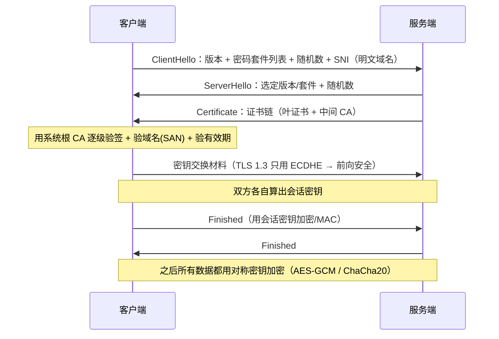

# 第 6 章：HTTPS 与 TLS（第 18 课）

本章解决的问题：**「加密加在哪一层，凭什么相信对面是真的」**。

代码：`05_http/demo_18_https_tls.py`

---

## 一句话原理

**HTTPS = HTTP 跑在 TLS 之上**。HTTP 报文一个字都没改，只是被整个包进了一条加密隧道：

```
应用层   HTTP / SMTP / DNS-over-TLS        ← 明文内容在这里
──────────────────────────────────────
安全层   TLS（记录协议 + 握手协议）
──────────────────────────────────────
传输层   TCP（443 端口；HTTP/3 则用 QUIC/UDP）
──────────────────────────────────────
网络层   IP
```

**最容易被误解的一点**：HTTPS 的安全性**不是来自「加密」本身**，
而是来自「证书链 + 主机名校验」建立起来的信任。本课用自签证书的四个实验证明它。

---

## 【原理】TLS 握手做了什么



为什么这么设计：**非对称加解密慢几个数量级**，所以只用它安全地换出一把对称密钥，
后续通信全用对称加密。TLS 1.3 更是压缩到 1 个 RTT（1.2 要 2 个）。

---

## 【实测】`05_http/demo_18_https_tls.py`

### ① 连真实站点，看握手结果

```text
  默认上下文: 校验模式=2, 检查主机名=True
  底层 OpenSSL: OpenSSL 3.6.3 9 Jun 2026
  握手成功:
    TLS 版本      : TLSv1.3
    密码套件      : TLS_AES_256_GCM_SHA384
    套件协议版本  : TLSv1.3,  密钥长度 256 位
    会话是否复用  : False
    ALPN 协商结果 : None
  服务端证书:
    主题 (subject)  : example.com  [commonName=example.com]
    签发者 (issuer) : SSL Corporation
    有效期          : Sep 26 22:49:11 2026 GMT  ->  Dec 25 22:56:35 2026 GMT （还剩 72 天）
    序列号          : 01EEE6AABB521D5E14FC315FD9985690
    版本            : v3
    SAN（这证书对哪些域名有效）: ['example.com', '*.example.com']
```

逐条读：

- `校验模式=2` 是 `CERT_REQUIRED`，`检查主机名=True` —— 默认就是**最严**的配置，别去放松它；
- 密码套件 `TLS_AES_256_GCM_SHA384` 的构成：AEAD 对称加密（AES-256-GCM）+ 摘要（SHA384），
  TLS 1.3 里密钥交换固定是 (EC)DHE，所以**天然前向安全**；
- 有效期 90 天（`Sep 26 → Dec 25`）—— Let's Encrypt 推动的短周期，所以**必须自动化续期**；
- **`SAN` 才是现代客户端校验的东西**，`CN` 早就被忽略了；
- `ALPN 协商结果: None` 是因为这一步的客户端上下文没有声明支持的协议（下面第 ④ 步会声明）。

### ② 证书链（4 张，从叶到根）

这张链一共有 4 张（`get_verified_chain()` 返回的已是校验过的链）：

| # | 字节数 | 是谁 |
|---|---|---|
| 1 | 1002 | 叶证书 `CN=example.com`，签发者 `Cloudflare TLS Issuing ECC CA 3` |
| 2 | 742 | 中间 CA：`Cloudflare TLS Issuing ECC CA 3` |
| 3 | 824 | 交叉签发的中间 CA：`SSL.com TLS Transit ECC CA R2` |
| 4 | 574 | 根 CA：`SSL.com TLS ECC Root CA 2022`（自签） |

（完整的 `subject | issuer` 逐字输出在 `.logs/demo_18_https_tls.log` 里；
表格是为可读性做的归纳，字节数与 CA 名字都取自该日志。）

链式信任就是逐级验签：**叶证书由中间 CA 签名 → 中间 CA 由根 CA 签名 → 根 CA 在本机信任库里**。

```
签名方向：Root CA(自签) ──签发──► Transit CA ──签发──► Issuing CA ──签发──► example.com 的证书
校验方向：客户端用本机根部 CA 验第一级，逐级往下，最后确认叶证书可信且域名匹配
```

**工程含义**：服务器必须把「自己的证书 + 中间 CA」都发出去，
漏发中间证书会让部分老客户端报 `unable to get local issuer certificate`（浏览器常能自动补，SDK 往往不行）。

### ③ SNI 实验：同一个 IP，带不带域名差别巨大

```text
  example.com 解析到 172.66.147.243（同一台服务器上显然不只托管一个网站）

  (a) 不发送 SNI（直接连 IP, 不带 server_hostname）:
      握手直接被拒: [SSL: SSLV3_ALERT_HANDSHAKE_FAILURE] ssl/tls alert handshake failure
      <- 这是很多 CDN 的做法: 没有 SNI 就不知道怎么选证书, 干脆拒掉。
         所以「用 IP 直连 + 自己填 Host 头」这个 HTTP 时代的技巧,
         在 HTTPS 下根本行不通 —— 握手阶段就必须提供域名。

  (b) 发送 SNI=example.com:
      拿到正确证书, SAN 包含 example.com: True
      SAN 列表: ['example.com', '*.example.com']
```

SNI 是**明文**的（在 ClientHello 里），所以中间人能看到你访问的域名（看不到路径和内容）。
对策是 ECH（Encrypted Client Hello），已在部分浏览器/厂商落地。

### ④ 自签证书实验：亲手证明「安全性来自信任链」

本地用 `openssl` 生成一张自签证书（SAN = `localhost` / `127.0.0.1`），
起一个 TLS 服务器，然后从四个角度去连它：

```text
  (a) 客户端用系统信任链校验 -> 应该失败:
      SSLCertVerificationError: self-signed certificate
      <- 这就是浏览器里那句「您的连接不是私密连接」的技术真相

  (b) 把这张自签证书加入信任列表（相当于手动「信任」它）-> 成功:
      握手成功: TLSv1.3, 套件 TLS_AES_256_GCM_SHA384
      ALPN 协商结果: http/1.1
      证书主题: {'commonName': 'localhost', 'organizationName': 'python-net-course'}
      加密通道里的 HTTP 响应: HTTP/1.1 200 OK
      解密后的 body: 'hello from a self-signed HTTPS server'

  (c) 关闭证书校验（verify_mode=CERT_NONE）-> 也成功, 但这是不安全的:
      握手「成功」, 但证书完全没验证 -> 中间人换一张自己的证书你也发现不了
      getpeercert() 返回空: {}

  (d) 证书有效但域名不匹配 -> 失败（主机名校验独立于 CA 校验）:
      SSLCertVerificationError: [SSL: CERTIFICATE_VERIFY_FAILED] certificate verify failed:
        Hostname mismatch, certificate is not valid for 'evil.example.com'.
```

**把这四行连起来读，就是 HTTPS 的全部安全模型**：

| 实验 | 配置 | 结果 | 说明 |
|---|---|---|---|
| (a) | 默认校验 | ❌ 拒绝 | 自签 CA 不在信任库里，无法建立信任链 |
| (b) | 把自签证书当 CA 信任 | ✅ 成功 | 信任是「配置出来的」—— 这正是 CA 存在的意义 |
| (c) | `CERT_NONE` | ✅ 成功但**无意义** | 数据加密给了一个冒充者；`getpeercert()` 是空的 |
| (d) | 信任链 OK，域名不匹配 | ❌ 拒绝 | 挡住「攻击者用自己的合法证书冒充你的站点」 |

对应到真实世界的坏味道：`verify=False`、`curl -k`、`rejectUnauthorized: false` —— 它们等于把 (c) 写进生产代码。

### ⑤ ALPN：握手时顺便把 HTTP 版本谈好

```
ALPN（Application-Layer Protocol Negotiation）
  客户端在 ClientHello 里列出 ["h2", "http/1.1"] → 服务端挑一个放回 ServerHello
  好处：不用多花一个来回就知道该说 HTTP/2 还是 HTTP/1.1
```

上面 (b) 之所以能协商出 `http/1.1`，是因为客户端和服务端都显式声明了；
① 里是 `None` 因为客户端没声明。真实站点大多协商成 `h2`，
支持 HTTP/3 的还会用 `Alt-Svc` 头告诉浏览器「下次可以用 h3（UDP 443）」——

### ⑥ 真实 HTTPS 请求（HTTPS = TLS 隧道里的 HTTP）

```text
  HTTPS GET https://example.com/ -> 200 OK
  响应头: Content-Type=text/html; charset=utf-8, Content-Length=None, Transfer-Encoding=chunked
    注意: 这条响应用的是 chunked（第 15 课）而不是 Content-Length,
          所以头里没有长度 —— http.client 已经替你把分块解好了。
  body 前 80 字节: b'<!doctype html><html lang=en><head><meta charset=utf-8><link rel=icon href=data:'
  底层 TLS 版本: TLSv1.3（socket 被替换成了 SSLSocket）
```

注意最后一行：`HTTPSConnection` 做的事就是「TCP → 包一层 TLS → 在上面说 HTTP」。
**HTTP 协议的语义完全没变**（第 15~17 课的知识全部适用）。

---

## 【生产清单】

**证书**
- 用 ACME（Let's Encrypt）自动签发与续期；监控到期时间（至少提前 21 天告警）
- 证书链要发全（包含中间 CA）

**协议与套件**
- 只允许 TLS 1.2+，优先 1.3；关掉压缩（CRIME）、重协商、RC4/3DES
- 优先 ECDHE + AEAD（AES-GCM / ChaCha20-Poly1305）

**应用层**
- 开 HSTS（`Strict-Transport-Security`）防降级
- Cookie 加 `Secure` + `HttpOnly` + `SameSite`
- 内网服务间也用 TLS（mTLS），「内网安全」是过时假设

**排障命令**

```bash
openssl s_client -connect example.com:443 -servername example.com -showcerts   # 握手细节 + 证书链
openssl x509 -in cert.pem -noout -subject -issuer -dates -ext subjectAltName  # 单张证书
```

| 报错 | 常见原因 |
|---|---|
| `Hostname mismatch` | SAN 与访问的域名不符（IP 直连最常见） |
| `unable to get local issuer certificate` | 服务器漏发中间证书，或客户端 CA 库太旧 |
| `certificate has expired` | 证书过期 |
| 只有某个客户端报错 | 它不支持你的 TLS 版本/套件（老 Android、老 Java） |

---

## 【坑】

- 为了「连通就行」在生产里 `verify=False` / `curl -k` —— 等于没有 HTTPS（实验 (c)）。
- 只看 CN 不看 SAN —— 现代证书的 CN 常常是空的或无关的。
- 手工上传证书、忘了续期 —— 90 天周期下这是最常见的线上事故之一。
- 用 IP 直连 + Host 头访问 HTTPS 服务 —— 握手阶段就可能被拒（实验 (a)）。
- 把 HTTPS 当成「性能开销很大」而不用 —— TLS 1.3 只有 1 个 RTT，且有会话复用。

---

## 【练习】

1. 把 `context.set_alpn_protocols(["h2", "http/1.1"])` 加到本地自签服务器和客户端上，
   看协商结果变成什么（提示：本课服务器只声明了 `http/1.1`，要两边都改）。
2. 把自签证书的有效期改成 1 天，第二天再跑一次 `demo_18`，观察实验 (b) 的报错变化
   （从「自签不可信」变成「已过期」）。
3. 用 `openssl s_client -connect example.com:443 -servername example.com` 手工看一遍，
   和本课 Python 打印的证书字段对照。

---

## 本章小结

| 结论 | 验证方式 |
|---|---|
| HTTPS = HTTP 跑在 TLS 之上 | 用 `HTTPSConnection` 拿到 200，底层 socket 是 `SSLSocket`，TLSv1.3 |
| TLS 1.3 握手结果可观测 | 打印版本、密码套件、ALPN、会话复用标志 |
| 证书要看 SAN / 有效期 / 签发链 | 打印 SAN、90 天有效期、4 张证书链 |
| 服务器要发全证书链 | 逐张打印 subject \| issuer，能看到从叶到根的完整链条 |
| SNI 在握手中是明文且必需 | 不发送 SNI → `handshake_failure`；发送 → 拿到正确证书 |
| 安全性来自信任链而非加密 | 自签证书四实验：(a) 拒绝 (b) 成功 (c) 空证书成功 (d) 域名不符拒绝 |
| ALPN 在握手时协商应用层协议 | 客户端/服务端都声明 → 协商出 `http/1.1` |
| 生产三大纪律 | 自动化续期、只允许 1.2+、永不关校验 |

下一章：[07-综合项目与并发模型.md](07-综合项目与并发模型.md) —— 把前 18 课组装成一个真服务器。
