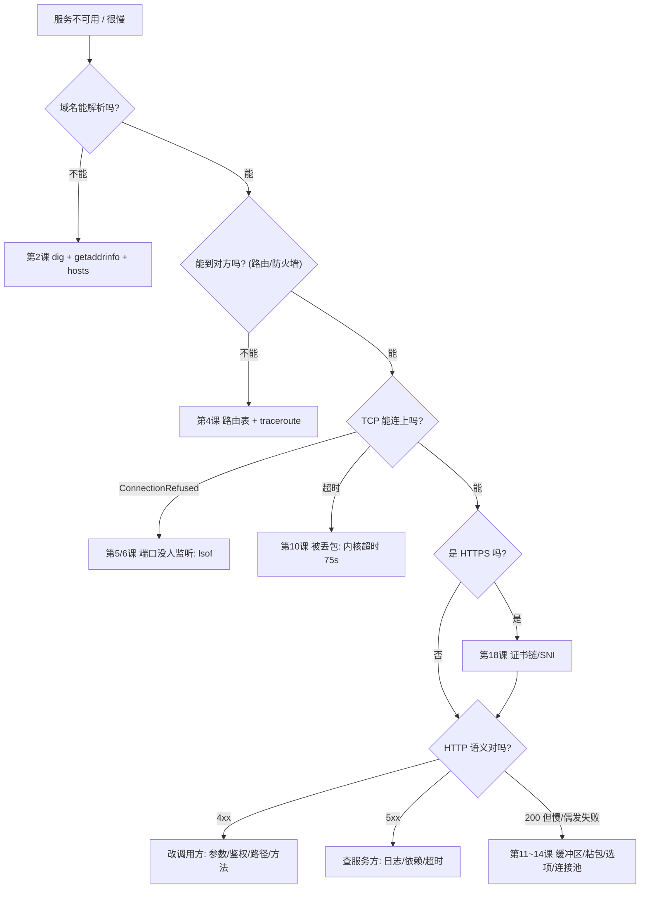

# 第 8 章：实战排障手册

本章不引入新知识，而是把前 7 章的结论组织成**「症状 → 动作 → 本课实测案例」**的形式。
配合 `../NOTES.md` 的速查表一起用：那份是「查表」，这份是「查案例」。

---

## 总览：一条链，从外往里排



---

## 案例 1：域名解析有问题

**症状**：`getaddrinfo failed` / 首次请求特别慢 / 改了 DNS 才能访问内网。

```bash
dig +short example.com                     # 能解析出什么
dig @8.8.8.8 example.com                   # 换服务器对比（判断是不是本地 DNS 的问题）
scutil --dns | head -20                     # macOS: 实际生效的 DNS 服务器（注意 if_index）
cat /etc/hosts                             # hosts 优先于 DNS
```

**本课实测**：同一域名连续解析 4 次 —— `51.900ms → 1.609ms → 2.456ms → 2.015ms`（第 2 课）。
**结论**：首次慢多半是缓存冷，不是带宽问题。
**并注意**：本机 DNS 列表里如果出现 CGNAT 段地址（`100.64.0.0/10`）或挂在隧道网卡上的 DNS，说明有 VPN 在分流解析 ——
「VPN 开了之后内网域名解析不了 / 某些域名走了错误的 DNS」都从这里查。

---

## 案例 2：连不上，而且分不清是"拒绝"还是"超时"

**症状**：`ConnectionRefusedError`（瞬间）或 `socket.timeout`（等很久）。

```python
import socket, errno, time
s = socket.socket(); s.settimeout(2)
t = time.time()
code = s.connect_ex(("host", 443))
print(code, errno.errorcode.get(code), f"{time.time()-t:.3f}s")
```

**本课实测**（第 10 课）：

```text
  连 192.0.2.1:80 -> socket.timeout（我们自己设的 1 秒到了就放弃, 实际等了 1.00s）
  连 127.0.0.1:1 -> ConnectionRefusedError（只等了 0.0006s）
```

| 结果 | 含义 | 下一步 |
|---|---|---|
| 瞬间 `ECONNREFUSED` | 网络通、主机在、**端口没监听**（或防火墙 reject） | `lsof -nP -iTCP:<port>` |
| 超时 | 包被丢弃 / 主机不在 / 路由不通 | `traceroute`，查安全组/防火墙 |
| `EHOSTUNREACH`/`ENETUNREACH` | 本机没有到那个网段的路 | 查路由表、VPN |

**别忘了一个数字**：内核默认要等 **75 秒**（`net.inet.tcp.keepinit`）才会自己放弃。
业务不设超时，线程就被钉在那里。

---

## 案例 3：`Address already in use`

**症状**：服务重启失败，`OSError: [Errno 48]`。

```bash
lsof -nP -iTCP:8080            # 谁在占？是 LISTEN 还是 TIME_WAIT
ps -p <PID> -o pid,user,command # 是哪个程序
```

**本课实测**（第 6、13 课）：

```text
不加 SO_REUSEADDR 直接 bind: 失败 -> OSError: [Errno 48] Address already in use
      <- 明明没有进程在监听了, 却还是 Address already in use, 就是 TIME_WAIT 在占位。
加上 SO_REUSEADDR 后 bind 同一个端口: 成功
```

| 占用者状态 | 结论 |
|---|---|
| `LISTEN`（旧进程还在） | 杀掉旧的，或换端口 |
| `TIME_WAIT`（已无进程） | 代码里加 `SO_REUSEADDR`（一行解决） |

---

## 案例 4：连接被对端复位（RST / BrokenPipe）

**症状**：`ConnectionResetError: [Errno 54]` / `BrokenPipeError: [Errno 32]`。

**本课实测**（第 13 课）：

```text
第 1 次 send 返回 16 字节（看起来成功, 其实只是写进了内核缓冲）
第 2 次 send -> BrokenPipeError: [Errno 32] Broken pipe
服务端 recv -> ConnectionResetError: [Errno 54] Connection reset by peer   ← 对端 SO_LINGER=0
```

**排查顺序**：
1. 对端是不是已经关了？（看自己的 `close()` 时机，以及是否用了 `shutdown(SHUT_WR)` 半关闭）
2. 对端是不是崩了 / 被 `kill -9`？
3. 中间的负载均衡是不是把空闲连接回收了？（keepalive 默认要 2 小时才判死，第 14 课）

**关键认知**：`send` 成功 ≠ 对方收到。需要**应用层确认或心跳**。

---

## 案例 5：`CLOSE_WAIT` 堆积

**症状**：`netstat` 里某端口一堆 `CLOSE_WAIT`，内存/fd 慢慢涨。

```bash
netstat -an -f inet -p tcp | awk '{print $NF}' | sort | uniq -c | sort -rn
lsof -nP -iTCP -sTCP:CLOSE_WAIT
```

**本课实测**（第 13 课）：故意不 `close()` → 立即出现 `CLOSE_WAIT: 1`；`close()` 之后立刻消失。
**结论**：`CLOSE_WAIT` 一定是**代码问题**（收到 FIN 后没关），调内核参数没有用。
顺着 `lsof` 找到 PID，检查所有 `return`/异常分支是否漏了关闭（用 `with` / `try-finally` 兜住）。

---

## 案例 6：`TIME_WAIT` 堆积 / 临时端口耗尽

**症状**：`bind: Cannot assign requested address`（EADDRNOTAVAIL）；`netstat` 里几万条 `TIME_WAIT`。

```bash
netstat -an -f inet -p tcp | grep -c TIME_WAIT
sysctl net.inet.ip.portrange.first net.inet.ip.portrange.last    # 可用临时端口范围
sysctl net.inet.tcp.msl                                          # 2*MSL 时长
```

**本课实测**（第 13 课 `--wait` 模式）：

```text
  当前端口 57589 状态: {'TIME_WAIT': 25}
    t+25s: {'TIME_WAIT': 25}
    t+30s: {}
  TIME_WAIT 消失 -> 这正是 2*MSL 到期。
```

**处理优先级**：① 用连接池/keep-alive 减少连接数（治本）→ ② 让客户端当主动关闭方 →
③ 最后才考虑调内核参数。

---

## 案例 7：吞吐上不去

**症状**：带宽明明够，但传输速度只有理论值的零头。

**本课实测**（第 14 课）：32 MiB 传输，缓冲区从 ~143KB 缩到 8KB：

```text
    默认缓冲区   :     10.3 ms  ->  3259 MB/s
    SNDBUF=8192 :     63.6 ms  ->   528 MB/s
```

**排查项**：
1. 内核缓冲区够不够（BDP = 带宽 × RTT，跨地域链路常常不够）；
2. 是不是**一条连接**在传大文件（多连接并行往往更有效）；
3. 应用层是不是在做「多次小写」（第 14 课：2000 次 1 字节写）；
4. 单条 TCP 连接的窗口/拥塞控制（跨洋链路 RTT 高，窗口受限）；
5. 有没有 TLS 重新握手（会话复用开了吗）。

---

## 案例 8：偶发几十毫秒延迟尖刺

**症状**：P99 很差，P50 很好。

**排查项**：
1. **Nagle + 延迟确认**（第 14 课）：小包 + 高 RTT 时会互相等。低延迟协议开 `TCP_NODELAY`，
   但更该先消除「多次小写」；
2. **DNS 冷缓存**（第 2 课：51.9ms → 1.6ms）；
3. **连接池太小**：排队等待；
4. **keep-alive 连接被中间设备回收**，你复用了一条已死的连接，第一次写触发重建/超时；
5. **GC / 全局锁**：应用层问题，也会表现为网络延迟。

---

## 案例 9：HTTPS 证书相关

```bash
openssl s_client -connect example.com:443 -servername example.com -showcerts </dev/null
openssl x509 -in cert.pem -noout -subject -issuer -dates -ext subjectAltName
```

**本课实测**（第 18 课）：

| 报错 | 本课复现方式 | 原因 |
|---|---|---|
| `self-signed certificate` | 用自签证书 + 默认校验 | 不在信任库里 |
| `Hostname mismatch ... 'evil.example.com'` | 信任了自签证书但访问别的域名 | SAN 不匹配 |
| `SSLV3_ALERT_HANDSHAKE_FAILURE` | 连 IP 不带 SNI | CDN 不知道给哪张证书，直接拒 |
| 握手成功但 `getpeercert() == {}` | `verify_mode=CERT_NONE` | **没有验证**，等于没有 HTTPS |

---

## 案例 10：UDP 丢包

**症状**：DNS 偶发超时 / 音视频卡顿 / 自研 UDP 协议丢消息。

**本课实测**（第 8 课）：接收缓冲缩到 2048 字节，500 发 11 收（丢 489）。

**排查项**：
1. 接收端读得够快吗？`SO_RCVBUF` 多大？
2. 包是不是超过 MTU（1472 / 隧道更小）导致分片？
3. 有没有做**应用层**的序号 + 重传（UDP 本身不提供）？
4. 客户端有没有 `connect()`（否则收不到 ICMP 错误反馈）？

---

## 案例 11：「日志说发出去了，对方说没收到」

**本课实测**（第 13 课）：第 1 次 `send` 返回 16 字节（成功），第 2 次才 `BrokenPipeError`。

**结论**：
- `send` 成功只代表「字节进了本机内核缓冲区」；
- 要确认真实送达，必须有**应用层确认**（响应报文 / ACK / 回调）或**心跳**。

---

## 案例 12：「本地能跑，上线就出问题」

这是新手最常问的问题，本课给出了四个具体机制：

| 现象 | 机制 | 来自哪一课 |
|---|---|---|
| 本地小消息正常，线上大消息被截断 | 一次 `recv` 拿到的长度由缓冲区决定，不是「一条消息」 | 第 11、12 课 |
| 本地不发丢包，线上偶发丢 | 缓冲区溢出 / 分片 / 拥塞 | 第 8、14 课 |
| 本地延迟 1ms，线上偶发 40ms | Nagle + 延迟确认 / DNS / 队头阻塞 | 第 14、2 课 |
| 本地连接不断，线上偶发 `BrokenPipe` | 中间设备回收空闲连接 | 第 14 课（keepalive 默认 2 小时） |
| 本地 MTU 16384（回环），线上 1500/1280 | 回环不分片，真实链路分片 | 第 3、8 课 |

---

## 黄金命令表（按排查顺序）

```bash
# 1. 解析
dig +short example.com
scutil --dns | grep nameserver          # macOS 上真正生效的 DNS

# 2. 路由与连通
netstat -rn -f inet | head
traceroute -n -m 8 example.com

# 3. 端口与进程
lsof -nP -iTCP:8080                     # 谁占了端口
lsof -nP -iTCP -sTCP:LISTEN              # 所有监听者
netstat -an -f inet -p tcp | awk '{print $NF}' | sort | uniq -c | sort -rn   # 状态分布

# 4. 内核参数
sysctl net.inet.tcp.msl net.inet.tcp.keepinit
sysctl net.inet.ip.portrange.first net.inet.ip.portrange.last

# 5. TLS
openssl s_client -connect host:443 -servername host </dev/null 2>/dev/null | head -30

# 6. HTTP
curl -v --http1.1 https://example.com/ -o /dev/null     # 看头、看连接复用（"Re-using existing connection"）
curl -i --range 0-99 https://example.com/               # 206 / Content-Range
curl -i -H 'If-None-Match: "xxx"' https://example.com/  # 304
```

**没有 root、抓不了包怎么办**：本课全程演示了替代方案 ——
`netstat` 看状态、`lsof` 看归属、`sysctl` 看内核参数、
自己写 socket 客户端观察 `connect_ex`/`SO_ERROR`、打印 `getsockopt` 读回值。
**这些证据在排障价值上往往比一次抓包更直接。**

---

## 一张对照表：异常类型 → 含义 → 能不能重试

| 异常 | 含义 | 重试？ |
|---|---|---|
| `ConnectionRefusedError` | 端口没人监听 / 防火墙 reject | 可以（换实例），但有上限 |
| `socket.timeout`（连接阶段） | 包被丢弃 / 路由不通 | 谨慎，注意总超时预算 |
| `socket.timeout`（读阶段） | 对端太慢 | 视幂等性而定 |
| `ConnectionResetError` | 对端/中间设备复位 | 幂等操作可重试 |
| `BrokenPipeError` | 往已关闭的连接写 | 通常要重建连接 |
| `ssl.SSLCertVerificationError` | 证书问题 | **不要重试**，要修配置 |
| `HTTPError 4xx` | 调用方问题 | **不要重试**（除非 408/429） |
| `HTTPError 5xx` | 服务方问题 | 幂等 + 退避重试 |

---

## 一句话版本

> **先分层定位（DNS → 路由 → 端口 → TCP → TLS → HTTP → 应用），再看状态（LISTEN/ESTABLISHED/TIME_WAIT/CLOSE_WAIT），
> 最后才动参数（缓冲区、超时、keepalive）。**
> 顺序反了，就会花一整天调一个根本不存在的性能问题。

---

下一章：[09-进阶路线.md](09-进阶路线.md) —— 说清这套课没讲什么，以及每个方向的第一步怎么迈。
