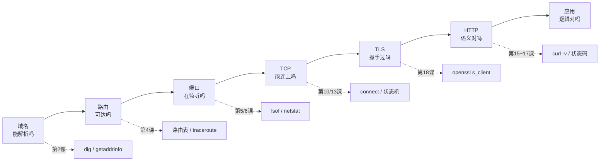

# 教学文档：从 IP 地址到 HTTPS

配套代码：`python-net-course/`（19 个可运行示例，全部只用 Python 标准库）
配套速查：`../NOTES.md`（表格/时序图/决策树，写作时手边翻）

---

## 这份文档和代码是什么关系

不是「文档讲概念、代码做例子」两套东西，而是同一件事的两种呈现：

| 层 | 位置 | 作用 |
|---|---|---|
| 代码 | `<章节>/demo_XX_*.py` | **唯一事实来源**，头部 docstring 讲原理，`# 第 N 步` 分段做验证 |
| 输出 | `.logs/demo_XX_*.log` | 真实运行结果（本机 19/19 通过），文档里引用的数字都出自这里 |
| 文档 | `doc/0X-*.md`（你正在看的） | 把「原理 → 代码 → 实测 → 坑 → 练习」串成一条可读的线 |
| 速查 | `../NOTES.md` | 表格化速查（端口表、状态表、选项表、排障树） |
| 校验 | `../tools/check_doc_quotes.py` | 校验本文档里每一条实测引用都能在 `.logs/` 中找到出处 |

**校验文档自身**（可选，但推荐）：

```bash
bash run_all.sh                       # 先刷新日志
python3 tools/check_doc_quotes.py     # 校验 doc/ 里的实测引用都有日志出处
```

**读法建议**（每一章都这么走一遍）：

1. 先读本文档对应小节，建立预期（「我应该看到什么」）。
2. 跑一次代码，拿 `.logs/` 里的输出跟文档里的实测对照。
3. 读代码，重点看 `# 第 N 步` 之间那几行——那是把原理变成实验的全部关键。
4. 做一题「动手改一改」，看结论是否如预期。**不动手，这套材料只发挥 30%。**

---

## 运行环境（文档里所有实测输出都来自这台机器）

```
macOS（Darwin 25）arm64，Python 3.13.0
网卡 en0    : 192.168.1.10/23（网关 192.168.1.1），MTU 1500
回环 lo0    : MTU 16384
额外网卡    : utun10（10.16.11/24，VPN/组网隧道）、bridge100、vmenet0
DNS 服务器  : 192.0.2.53（隧道网卡）、192.0.2.54（en0）
工具        : dig / curl / lsof / netstat / traceroute / openssl / sysctl 均在
日期        : 2026-10-14
```

三类数字会变，阅读时注意区分：

- **随机器变**：IP、网关、网卡名、系统服务端口（本机是 5000/7000）、DNS 服务器
- **随时间变**：证书有效期、CDN 返回的 IP、DNS/HTTP 耗时
- **不会变的**：协议规则、报文格式、内核状态机、错误码语义、各种上限（MTU/MSS/端口范围）

---

## 章节索引

| 文档 | 课程 | 代码 | 你会亲手验证的核心结论 |
|---|---|---|---|
| [01-地址与DNS.md](01-地址与DNS.md) | 第 1~4 课 | `01_address_dns/` | IP 是 32 位整数、子网划分、DNS 缓存、MTU→MSS、路由最长前缀匹配 |
| [02-端口与socket.md](02-端口与socket.md) | 第 5~7 课 | `02_port_socket/` | 端口 16 位、bind 语义、五元组、lsof 排障、端口扫描三态 |
| [03-UDP与二进制协议.md](03-UDP与二进制协议.md) | 第 8~9 课 | `03_udp/` | 数据报边界、真实丢包、ICMP 反馈、手写 DNS 报文 |
| [04-TCP.md](04-TCP.md) | 第 10~14 课 | `04_tcp/` | 三次握手、字节流无边界、粘包三方案、四次挥手、socket 选项 |
| [05-HTTP.md](05-HTTP.md) | 第 15~17 课 | `05_http/` | HTTP 报文、body 长度三方案、自写服务器、客户端库的坑 |
| [06-HTTPS与TLS.md](06-HTTPS与TLS.md) | 第 18 课 | `05_http/demo_18_https_tls.py` | TLS 握手、证书链、SNI、四种证书校验结果 |
| [07-综合项目与并发模型.md](07-综合项目与并发模型.md) | 第 19 课 | `06_project/` | Range/304/HEAD、线程 vs 事件循环实测对比 |
| [08-实战排障手册.md](08-实战排障手册.md) | 综合 | 全部 | 症状 → 命令 → 案例 → 结论 |
| [09-进阶路线.md](09-进阶路线.md) | 综合 | —— | 这套课没讲的部分，以及下一步怎么走 |

---

## 学习路线（三种节奏）

**A. 三天通读（每天 2~3 小时）**

```
Day 1: 01（地址/DNS/链路/路由） + 02（端口）+ 03（UDP）
       └ 目标：能解释「输入网址到发出第一个 TCP 包，中间发生了什么」
Day 2: 04（TCP 全部）—— 这是全课程的重心，慢一点
       └ 目标：能自己在纸上画出握手/挥手/状态迁移，并说清粘包为什么不可避免
Day 3: 05（HTTP）+ 06（TLS） + 07（综合项目）
       └ 目标：能用 socket 手写一个请求，并解释 HTTPS 到底在防什么
```

**B. 按需查阅（面试/排障前突击）**

先看 `../NOTES.md` 的速查表定位问题类型，再跳到本文档对应小节看「实测」和「常见坑」。

**C. 动手为主（推荐给要写网络代码的人）**

按顺序做每小节的「动手改一改」，把文档当实验手册，代码当参考实现。

---

## 文档里的标记约定

```
【原理】  机制本身，跨平台不变
【实测】  本机真实输出，附代码文件与日志出处
【坑】    真实项目里踩过的问题（大多是「看起来对，其实错」的那种）
【练习】  改一个数字/一行代码，观察结论是否变化
```

引用实测输出时一律用 `text` 代码块，并且**保留原样**（包括中文标点、对齐空格），
方便你直接跟自己跑出来的结果逐行对比。

---

## 一条贯穿全课程的主线

如果只记一件事，就记这个**分层排查顺序**：



后面的每一课，本质上都在把这条链上的一环拆开给你看。
